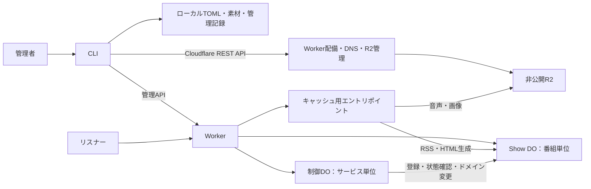

# 全体アーキテクチャ

castloopは、管理者のCloudflareアカウントで動くPodcastホスティング基盤です。管理者はCLIで番組とエピソードを編集・公開します。リスナーは、RSS（Feed）、音声、カバー画像、内蔵番組サイトをHTTPで取得します。

本書ではサービスの構成と主要な処理を説明します。次に[保存構造](data/storage.md)を読むと、各処理が使うデータの配置を確認できます。

## サービスの構成

1サービスは、1個のWorker、1個の非公開R2バケット、SQLiteを使うDurable Objects（DO）で構成します。DOは、サービス全体を扱う制御DOと、番組ごとの公開内容を扱うShow DOに分かれます。

| コンポーネント | 役割 |
| --- | --- |
| [CLI](components/cli.md) | ローカル入力の検証、プレビュー、素材のアップロード、公開、サービス管理 |
| Worker | オリジン・パス・対象Showを確認し、管理APIと公開配信を振り分ける |
| [制御DO](components/control-do.md) | Showの登録・一覧取得と、サービス全体の独自ドメイン変更 |
| [Show DO](components/show-do.md) | 番組ごとの公開内容、履歴、公開状態、予約、配信統計の管理 |
| [配信・キャッシュ](components/delivery.md) | 配信可否を確認した要求に対し、素材の取得やRSS・HTMLの生成を行う |
| R2 | 音声・カバー画像とサービス設定の保存 |

制御DOの名前は `service/<service_id>`、Show DOは `show/<service_id>/<show_id>` です。同じDOクラスから作られますが、保存先のSQLiteは独立しています。通常の公開・配信は対象のShow DOで処理します。

## データの役割

| 保存先 | 保持するデータ |
| --- | --- |
| ローカルワークスペース | 編集用TOML、素材の原本、管理者キー、操作の進捗記録 |
| 制御DOのSQLite | Show登録簿、独自ドメイン接続情報 |
| Show DOのSQLite | 確定したメタデータ、履歴、公開状態、予約、配信統計 |
| 非公開R2 | SHA-256をキーにした音声・カバー画像、`system/service.toml` |

ローカルファイルは編集元、Show DOのSQLiteは公開内容の正本です。公開操作でSQLiteに内容を確定すると、配信に反映されます。音声と画像はR2に保存し、SQLiteからその素材を参照します。

## 公開・更新の流れ

1. CLIがTOMLと素材を検証し、現在の公開内容との差分を取得します。
2. 新規または変更された素材を、R2のハッシュ付きキーへアップロードします。
3. CLIがメタデータ、素材参照、更新元の版をShow DOへ送ります。
4. Show DOが対象と更新元を確認し、更新後のRSS・サイトを検証して、必要なキャッシュを消去します。
5. Show DOが、現在内容・履歴・短縮URLの対応・世代番号を1回のSQLiteトランザクションで確定します。

公開内容の版をリビジョンと呼びます。同じ内容を再送した場合は、現在のリビジョンを返します。内容を変える場合は更新元の版を照合するため、古いプレビューから別の更新を上書きすることを防げます。

R2へのアップロードとSQLiteへの確定は別の処理です。公開が失敗すると、R2に素材だけが残る場合があります。配信ではSQLiteで承認された素材参照を使うため、その素材が単独で公開されることはありません。素材の保持方針は[保存構造](data/storage.md)を参照してください。

## 公開配信の流れ

1. Workerが要求のオリジン、パス、HTTPメソッドを確認します。
2. Show DOが対象の公開状態を確認し、配信対象と世代番号を返します。
3. Workerが世代番号を添えて、キャッシュ用エントリポイントを呼び出します。
4. キャッシュに本文がなければ、音声・画像はR2から取得し、RSS・HTMLはShow DOのデータから生成します。

公開状態は、キャッシュに本文がある場合も毎回確認します。これにより、非公開化した内容を古いキャッシュから配信することを防ぎます。

## サービス管理の流れ

| 操作 | 処理 |
| --- | --- |
| `init` | 新規サービスの設定とリソースを作り、Workerを配備して稼働を確認する |
| `create-show` | 制御DOとShow DOに番組を登録し、ローカルの編集用TOMLを作る |
| `deploy` | 同じサービス設定でWorkerのコードを更新する |
| 独自ドメイン変更 | 変更前後の設定を保存し、Cloudflare側の接続、全Show DO、制御DO、ローカル設定の順に反映を確認する |

Showの登録後は `draft` 状態です。公開操作を行うと `published` になります。独自ドメイン変更は複数の保存先にまたがるため、各保存先の状態を確認しながら進めます。詳細は[制御DO](components/control-do.md)を参照してください。

## Workerの実装と配備設定

Workerのエントリポイントは `src/sqlite-worker.ts` です。CLIのビルド時にWorkerをバンドルして埋め込み、配備時には以下のバインディングを設定します。Compatibility Dateは `2026-10-16` です。

| バインディング | 用途 |
| --- | --- |
| `CASTLOOP_BUCKET` | 非公開R2バケット |
| `CASTLOOP_SQLITE` | DOクラス `SqlitePublicationService` の名前空間 |
| `CASTLOOP_ADMIN_KEY` | 管理APIの共有秘密。secret bindingとして設定 |
| `CASTLOOP_VERSION_METADATA` | 稼働Worker版の識別 |
| `CASTLOOP_SQLITE_CONFIG` | サービス設定のJSON |
| `CASTLOOP_SERVICE_ID` | サービス識別子 |
| `CASTLOOP_MANAGEMENT_ORIGIN` | 管理用オリジン |

`enable_ctx_exports` を有効にし、メディア・RSS用の `SqliteCachedAssets` とHTML用の `SiteCachedPages` をキャッシュ用エントリポイントとして公開します。標準エントリポイントのキャッシュと、Worker版をまたぐキャッシュ共有は無効です。

DOクラス名やバインディング名、保存形式は既存データとの接続に関わります。コードの整理ではこれらを維持します。設定・要求・SQLiteの形式は[スキーマ](data/schemas.md)にまとめています。

## 関連する設計と実装

- 次に読む資料：[保存構造](data/storage.md)、[スキーマ](data/schemas.md)
- 横断的な設計：[セキュリティ](security.md)、[テスト](testing.md)
- 実装：[Worker](../src/sqlite-worker.ts)、[Showの振り分け](../src/sqlite-show-routing.ts)、[配備メタデータ](../packages/shared/src/sqlite-worker-deployment.ts)、[CLIビルド](../scripts/build-cli.ts)
