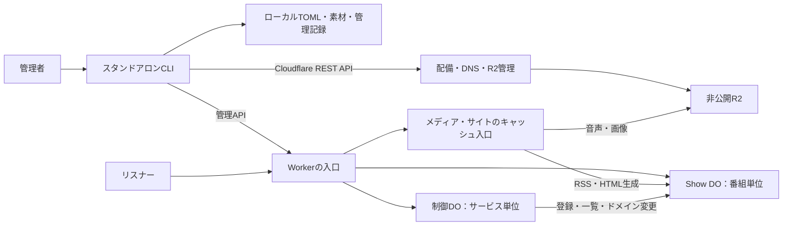

# 全体アーキテクチャ

castloopは、管理者のCloudflareアカウントに配備するPodcastホスティング基盤である。管理者は単一のCLIバイナリで番組を管理し、リスナーはRSS、音声、カバー画像、内蔵番組サイトをHTTPで取得する。

この設計文書群はv0.8.0の現行実装を対象とする。操作方法は[利用ガイド](../README.md)、開発環境は[CONTRIBUTING.md](../CONTRIBUTING.md)を参照する。

## 構成と責務

1サービスを1個のWorker、1個の非公開R2バケット、SQLite-backed Durable Objects（DO）で構成する。QueuesやD1は使わない。

| コンポーネント | 責務 |
| --- | --- |
| [CLI](components/cli.md) | ローカル入力の検証、差分確認、素材の直接配置、明示的な公開、配備・設定管理 |
| Workerの入口 | オリジン・パス・対象Showの判定。管理APIと公開配信の振り分け |
| [Show DO](components/show-do.md) | 各番組の公開内容、履歴、公開可否、予約、統計の保持と更新 |
| [制御DO](components/control-do.md) | Show登録・一覧取得、サービス全体の独自ドメイン変更の調整 |
| [配信・キャッシュ](components/delivery.md) | 公開可否の確認後にメディアを配信し、RSS・HTMLを必要時に生成してキャッシュ |
| R2 | 不変メディアとサービス設定の保存。公開済みメタデータの正本にはしない |

制御DOの名前は `service/<service_id>`、Show DOは `show/<service_id>/<show_id>`。同じDOクラスを使うが、SQLiteと公開状態はDOごとに分離する。通常の公開・配信は対象Show DOだけで完結し、制御DOを経由しない。

## データの正本

| 場所 | 正本とするもの |
| --- | --- |
| ローカルワークスペース | 管理者が編集するTOML、メディア原本、管理者キー、操作継続に必要な記録 |
| Show DO SQLite | 確定済みShow/Episodeメタデータ、リビジョン履歴、公開可否、予約、配信統計 |
| 制御DO SQLite | Show登録簿と独自ドメイン接続情報 |
| 非公開R2 | SHA-256をキーにした音声・カバー画像と `system/service.toml` |

ローカルファイルを編集しただけでは公開済み内容は変わらない。配信はローカルファイルではなく、SQLiteに確定した内容と承認済みメディア参照を使う。配置と保持方針は[保存構造](data/storage.md)を参照する。

## 主要フロー

### 公開・更新

1. CLIがTOMLと素材を検証し、現在の公開内容との差分・更新元の版を取得する。
2. 初回または変更された素材だけを、R2のコンテンツハッシュキーへ直接PUTする。
3. メタデータと素材参照をShow DOへ送る。
4. Show DOが対象・更新元・生成結果を検証し、必要なキャッシュパージを完了する。
5. 単一SQLiteトランザクションで公開内容・履歴・短縮URL対応・世代番号を確定する。

同一内容なら履歴を追加しない。素材配置とSQLite更新は分散トランザクションではないため、公開に失敗してもR2に素材が残る場合がある。残った素材だけで配信可能にはならず、失敗を理由に削除もしない。

### 公開配信

1. Workerが公開オリジン・許可パス・HTTPメソッドを検査する。
2. Show DOが公開可否と世代、配信対象を返す。
3. その判定を通った要求だけを、世代情報付きでキャッシュ入口へ渡す。
4. キャッシュミス時、音声・画像はR2から取得し、RSS・HTMLはShow DOのSQLiteから生成する。

キャッシュヒットでも公開可否の確認は省略しない。非公開化した内容が古いキャッシュから漏れないことが設計上の境界である。

### サービス管理

- `init` は新規サービスを作り、配備と稼働確認を行う。
- `create-show` はShowを登録してローカルTOMLを作るが、公開はしない。
- `deploy` は同一設定のコード更新。設定変更は独自ドメイン変更の専用処理で行う。
- 独自ドメイン変更は変更前後の設定を保存し、制御DOと全Show DOで反映を確認する。サービス全体をまたぐ単一トランザクションではない。

## 実装上の境界

| 項目 | 現行値 |
| --- | --- |
| サービス設定 | `schema_version = 2`、`storage_layout = "show-v1"` |
| 公開プロトコル | `sqlite-sequential-v1` |
| SQLite内部形式 | queue 14 / content 13、配信統計 1 |
| Show/Episodeメタデータ | `schema_version = 1` |
| Workerエントリポイント | `src/sqlite-worker.ts` |
| 配備時のCompatibility Date | `2026-10-16` |

新規環境のみを対象とし、異なる内部形式の変換や既存リソースの採用は行わない。設定版・内部DB形式・要求スキーマ版は別の識別子である。詳細は[スキーマ](data/schemas.md)を参照する。

### Workerの配備設定

| バインディング | 用途 |
| --- | --- |
| `CASTLOOP_BUCKET` | サービスの非公開R2バケット |
| `CASTLOOP_SQLITE` | SQLite-backed DOクラス `SqlitePublicationService` の名前空間 |
| `CASTLOOP_ADMIN_KEY` | 管理APIの共有秘密。secret bindingで渡す |
| `CASTLOOP_VERSION_METADATA` | 稼働Worker版の識別 |
| `CASTLOOP_SQLITE_CONFIG` | サービス設定のJSON |
| `CASTLOOP_SERVICE_ID` | サービス識別子 |
| `CASTLOOP_MANAGEMENT_ORIGIN` | 管理用オリジン |

`enable_ctx_exports` を有効にし、メディア・Feed用の `SqliteCachedAssets` とHTML用の `SiteCachedPages` をキャッシュ対応入口として公開する。標準入口のキャッシュとWorker版をまたぐキャッシュ共有は無効。クラス名・バインディング名・Compatibility Date・保存形式は、コード整理だけを理由に変更しない。

## 変更時に守ること

- 作成・プレビュー・素材配置では公開しない。
- 内容を変更する要求では設定・対象・更新元・世代を照合し、古い入力で上書きしない。
- 必要なパージが成功するまで公開内容を確定しない。
- 公開済みメディアと履歴を保持し、非公開化と物理削除を混同しない。
- 統計記録の失敗を配信失敗にしない。
- ローカル試験の成功を、Cloudflare上の性能や料金プラン適合の証明にしない。

認証と機密情報の扱いは[セキュリティ](security.md)、確認方法は[テスト](testing.md)を参照する。

## 主な定義元

- [WorkerとDOの接続](../src/sqlite-worker.ts)
- [Showへの振り分け](../src/sqlite-show-routing.ts)
- [Worker配備メタデータ](../packages/shared/src/sqlite-worker-deployment.ts)
- [CLIバイナリのビルド](../scripts/build-cli.ts)
